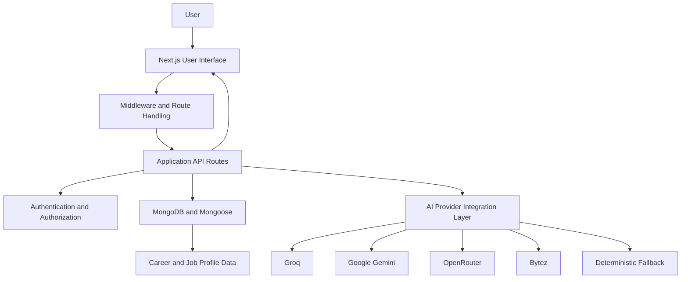

# PathFinder — AI-Powered Career Discovery & Guidance Platform

**Discover career paths. Explore opportunities. Build your roadmap.**

PathFinder is a web-based career guidance platform designed to help users explore career opportunities, discover relevant job profiles, compare career paths, and plan their professional development through a unified interface. It combines a modern web application architecture, database-backed career information, authentication, and a multi-provider AI integration layer.

**Live Demo:** https://pathfinder-system-sable.vercel.app/  
**GitHub Repository:** https://github.com/varun26pi/path-finder

---

## Table of Contents

- [Overview](#overview)
- [Problem Statement](#problem-statement)
- [Key Features](#key-features)
- [Application Modules](#application-modules)
- [Technology Stack](#technology-stack)
- [System Architecture](#system-architecture)
- [AI Integration and Fallback Strategy](#ai-integration-and-fallback-strategy)
- [Project Structure](#project-structure)
- [Getting Started](#getting-started)
- [Environment Configuration](#environment-configuration)
- [Database and Dataset Setup](#database-and-dataset-setup)
- [Available Commands](#available-commands)
- [Authentication and Security](#authentication-and-security)
- [Testing and Quality Checks](#testing-and-quality-checks)
- [Deployment](#deployment)
- [Engineering Decisions](#engineering-decisions)
- [Limitations and Future Improvements](#limitations-and-future-improvements)
- [Contributing](#contributing)
- [License](#license)

---

## Overview

Choosing a career involves more than finding a job title. Users need to understand available roles, compare opportunities, identify skill gaps, and determine what to learn next.

PathFinder brings these activities together in a single platform. It provides career exploration and comparison features, personalized guidance workflows, and AI-assisted functionality where supported by the configured providers.

The application is built with **Next.js, TypeScript, MongoDB, and Mongoose**, with Tailwind CSS for styling. Its AI integration layer supports multiple providers and includes a deterministic fallback path intended to keep supported workflows useful when external AI services are unavailable.

### Project Goals

- Make career exploration more accessible through a unified interface.
- Organize career and job-profile information for discovery and comparison.
- Support career guidance and recommendation workflows.
- Integrate AI services behind a common fallback strategy.
- Apply authentication to protected application pages and APIs.
- Maintain a modular codebase that can be tested and extended.

---

## Problem Statement

Career information is often scattered across job portals, learning platforms, and general-purpose AI tools. Users may struggle to connect a career goal with the skills, knowledge, and preparation needed to pursue it.

PathFinder aims to reduce this fragmentation by bringing career discovery, comparison, and guidance into one application.

The platform is intended to support career exploration and planning. Its recommendations should be treated as guidance rather than guarantees of employment or professional success.

---

## Key Features

### 1. Career Discovery

- Browse career-related information through the application.
- Explore available career and job-profile data.
- Navigate career information through dedicated application pages.

### 2. Career Guidance

- Access career-guidance workflows.
- Use AI-assisted functionality when a configured provider is available.
- Retain a deterministic fallback path for supported AI operations.

### 3. Career Recommendations

- Access the application's recommendation workflow.
- Use the available career information and supported application logic to explore possible career directions.

> Recommendation quality depends on the available data and the implementation of the recommendation workflow. Do not interpret suggestions as guaranteed outcomes.

### 4. Career Comparison

- Compare career options through a dedicated comparison interface.
- Use the comparison workflow to support informed career exploration.

### 5. Authentication

- Sign up for an account and log in.
- Use signed JSON Web Tokens (JWTs) for session authentication.
- Store the authentication token in an HTTP-only cookie.
- Hash passwords using bcrypt before storing them.

### 6. Multi-Provider AI Integration

PathFinder integrates multiple AI providers through a fallback-oriented design. This reduces dependence on a single external service and provides a path to deterministic behavior when configured providers cannot be used.

See [AI Integration and Fallback Strategy](#ai-integration-and-fallback-strategy) for details.

### 7. Database-Backed Application

- Use MongoDB for persistent application data.
- Use Mongoose for data modeling and database access.
- Provide a dataset-seeding script for importing job-profile data.

### 8. Automated Smoke Testing

- Include a smoke-test script that starts the production server and checks selected application pages and API endpoints.
- Include a system-test command that builds the application before running smoke tests.

---

## Application Modules

| Module | Purpose |
|---|---|
| Career exploration | Browse career-related information |
| Career guidance | Support career-planning workflows |
| Recommendations | Explore potential career directions |
| Career comparison | Compare career options |
| Authentication | Register users and authenticate sessions |
| AI integration | Connect supported AI providers with fallback behavior |
| Database layer | Store and retrieve application data |
| Dataset seeding | Import job-profile records |
| Smoke testing | Verify selected routes and API responses |

---

## Technology Stack

| Technology | Role |
|---|---|
| Next.js 16 | React framework and application routing |
| React 19 | User interface |
| TypeScript | Static typing and maintainability |
| Tailwind CSS | Styling and responsive UI development |
| MongoDB | Persistent data storage |
| Mongoose | MongoDB object modeling |
| JSON Web Tokens (JWT) | Token-based authentication |
| bcrypt | Password hashing |
| Groq, Google Gemini, OpenRouter, Bytez | Supported AI-provider integrations |
| pnpm | Package management and scripts |
| Vercel | Live application hosting |

*Provider availability and functionality depend on the current implementation, environment configuration, API quotas, and provider-side changes.*

---

## System Architecture

The application follows a modular web architecture that separates the user interface, server-side request handling, data access, and external AI integrations.



### Architectural Responsibilities

- **User interface:** Renders the application's pages and user-facing workflows.
- **Middleware and route handling:** Applies route-level access behavior.
- **API routes:** Handle server-side application requests.
- **Authentication:** Creates and verifies JWT-based sessions.
- **Data layer:** Uses Mongoose models to interact with MongoDB.
- **AI integration:** Coordinates supported provider calls and fallback behavior.
- **Dataset seeding:** Loads job-profile records into the database.

The diagram represents the intended high-level structure. The exact request flow and provider fallback behavior depend on the implementation of individual routes and modules.

---

## AI Integration and Fallback Strategy

PathFinder is designed to support multiple AI providers rather than depending exclusively on a single service.

The documented provider sequence is:

1. Groq
2. Google Gemini
3. OpenRouter
4. Bytez
5. Deterministic fallback

### Why use multiple providers?

External AI services can become unavailable because of rate limits, network failures, quota restrictions, configuration errors, or provider-side outages.

A fallback-oriented integration can help reduce the impact of those failures and make provider substitution easier.

### Design considerations

- Keep provider credentials on the server.
- Read API keys from environment variables.
- Handle failed requests and provider timeouts.
- Avoid exposing credentials in API responses or logs.
- Use deterministic behavior only for workflows that have an explicitly implemented fallback.
- Test provider failures as well as successful responses.

The presence of multiple provider integrations does not guarantee that every provider is configured or available at runtime.

---

## Project Structure

The repository is organized into application, component, data, model, utility, and testing areas.

```text
path-finder/
├── app/                  # Next.js application pages and API routes
├── components/           # Reusable UI components
├── data/                 # Career and job-profile datasets
├── hooks/                # Reusable React hooks
├── lib/                  # Shared utilities and server-side logic
├── models/               # Database models
├── public/               # Static assets
├── scripts/              # Dataset and testing scripts
├── styles/               # Application styling
├── middleware.ts         # Route access handling
├── next.config.mjs       # Next.js configuration
├── package.json          # Dependencies and npm scripts
├── pnpm-lock.yaml        # Dependency lockfile
├── tsconfig.json         # TypeScript configuration
└── README.md             # Project documentation
```

*This tree highlights the main directories; individual files may change as the project evolves.*

---

## Getting Started

### Prerequisites

Install the following before running the project locally:

- Node.js compatible with the project's Next.js version.
- pnpm.
- A MongoDB database or MongoDB Atlas connection.
- API credentials for whichever AI providers you intend to use.

Check the official [Next.js installation documentation](https://nextjs.org/docs/app/getting-started/installation) for current runtime requirements.

### 1. Clone the repository

```bash
git clone https://github.com/varun26pi/path-finder.git
cd path-finder
```

### 2. Install dependencies

```bash
pnpm install
```

### 3. Configure environment variables

Create a `.env.local` file in the repository root and configure the required values.

See [Environment Configuration](#environment-configuration) below.

### 4. Start the development server

```bash
pnpm run dev
```

Open [http://localhost:3000](http://localhost:3000) in your browser.

### 5. Build and run the production version

```bash
pnpm run build
pnpm run start
```

The production server uses Next.js's default port unless configured otherwise.

---

## Environment Configuration

PathFinder uses environment variables for database connectivity, authentication, and external service credentials.

Create `.env.local` in the project root. A template might look like this:

```dotenv
# Database
MONGODB_URI=

# Authentication
JWT_SECRET=

# AI providers — configure only those supported by your implementation
GROQ_API_KEY=
GEMINI_API_KEY=
OPENROUTER_API_KEY=
BYTEZ_API_KEY=
```

**Important:** Confirm the exact variable names against the provider integration files in `lib/` and the relevant API routes before using this template. The names above are illustrative for provider settings and may need to match your implementation exactly.

### Environment-variable guidance

- `MONGODB_URI` — MongoDB connection string.
- `JWT_SECRET` — secret used to sign and verify authentication tokens.
- AI-provider keys — credentials for configured AI services.

Generate a strong, random JWT secret for each environment. Never commit `.env.local`, real API keys, database credentials, or production secrets to GitHub.

If a provider is not configured, the corresponding AI functionality may be unavailable and behavior will depend on the application's fallback implementation.

---

## Database and Dataset Setup

PathFinder uses MongoDB and Mongoose to persist application data.

The repository includes a job-dataset seeding command:

```bash
pnpm run seed:jobs
```

The command is configured to execute:

```bash
node scripts/seed-job-dataset.mjs
```

Before running the script:

1. Configure `MONGODB_URI`.
2. Confirm that the database points to the intended development environment.
3. Inspect the script to understand whether it inserts, updates, replaces, or deletes existing records.
4. Back up important data before performing any destructive operation.

### Dataset organization

The repository README references career-related datasets for technology, management, and other non-management roles. The seeding script also references a chunked job-dataset directory.

Confirm the current dataset filenames and directories in the repository before relying on a particular dataset. Keep the dataset documentation synchronized with the actual seeding implementation.

---

## Available Commands

The following commands are defined in the project's `package.json`.

| Command | Description |
|---|---|
| `pnpm install` | Install dependencies |
| `pnpm run dev` | Start the development server |
| `pnpm run dev:webpack` | Start the development server using Webpack |
| `pnpm run build` | Build the production application |
| `pnpm run start` | Start the production server |
| `pnpm run lint` | Run ESLint |
| `pnpm run test:smoke` | Run the smoke-test script |
| `pnpm run test:system` | Build the application and then run smoke tests |
| `pnpm run seed:jobs` | Run the job-dataset seeding script |

Run the relevant checks before pushing changes:

```bash
pnpm run lint
pnpm run build
pnpm run test:smoke
```

For the combined build and smoke-test workflow:

```bash
pnpm run test:system
```

A successful build or smoke test does not, by itself, prove that every feature, authorization rule, or external integration works correctly.

---

## Authentication and Security

Authentication is implemented using JSON Web Tokens and HTTP-only cookies.

### Current design

- User passwords are hashed using bcrypt.
- Login creates a signed JWT.
- The token is stored in an HTTP-only cookie.
- Token verification checks the signature and expiration in the JWT utility.

### Security considerations

A secure production deployment should ensure that:

- Every protected API validates the token rather than relying only on the presence of a cookie.
- Authorization checks are applied to privileged operations.
- Administrative routes enforce server-side role checks.
- Secrets are stored in environment variables.
- Authentication cookies use appropriate `HttpOnly`, `Secure`, and `SameSite` settings.
- Public endpoints expose only information intended for public access.
- Error responses do not reveal secrets, internal stack traces, or sensitive configuration.
- Database credentials are never hardcoded in scripts or committed to source control.

**Security note:** Route middleware that checks only whether a cookie exists is not sufficient authentication. Protected operations should verify the token's signature and expiration, and administrative operations should independently verify the user's role. Review these controls before using the application with sensitive data.

---

## Testing and Quality Checks

PathFinder includes an automated smoke-test script and a system-test command.

### Smoke tests

Run:

```bash
pnpm run test:smoke
```

The script starts a production server and checks selected pages and API endpoints, including authentication-related routes and selected protected routes.

### System test

Run:

```bash
pnpm run test:system
```

This command builds the application before executing the smoke tests.

### Recommended additional checks

Before a release, test the following scenarios manually or through automated tests:

- Successful signup and login.
- Invalid credentials and invalid form inputs.
- Access to protected pages without authentication.
- Requests containing expired or invalid tokens.
- Access to administrative endpoints with non-admin accounts.
- Database connection failures.
- Missing AI-provider credentials.
- Provider timeouts, errors, and rate limits.
- Career discovery, recommendations, comparison, and guidance workflows.
- Production deployment and environment-variable configuration.

Record test results only after executing the checks in the relevant environment.

---

## Deployment

The project has a live deployment:

**[Open PathFinder](https://pathfinder-system-sable.vercel.app/)**

For deployment, configure the application environment in the hosting provider and verify the following:

1. All required environment variables are configured.
2. MongoDB accepts connections from the deployed application.
3. Authentication secrets are strong and unique to the deployment.
4. The production build completes successfully.
5. Login, protected routes, and core career workflows work in production.
6. AI-provider integrations behave correctly when configured and when unavailable.
7. Public endpoints do not expose administrative or sensitive operational information.

### Deploying with Vercel

1. Import the GitHub repository into Vercel.
2. Configure the required environment variables in the project settings.
3. Confirm the correct build and package-manager settings.
4. Deploy the application.
5. Test the deployed URL and key user flows.

See the official [Vercel documentation for Next.js](https://vercel.com/docs/frameworks/nextjs) for deployment guidance.

---

## Engineering Decisions

### 1. TypeScript for maintainability

TypeScript helps make interfaces, function inputs, and data structures more explicit. Strict type checking can catch some errors before runtime.

### 2. Modular application structure

Separating pages, reusable components, models, utilities, and scripts helps keep responsibilities organized and makes future changes easier to isolate.

### 3. Database-backed career information

MongoDB and Mongoose provide a persistent data layer for career and job-profile information.

### 4. Multi-provider AI integration

A provider fallback design reduces reliance on a single AI service and creates room for future provider substitution.

### 5. Automated smoke testing

The smoke-test workflow provides a repeatable check of selected routes after a production build.

### 6. Environment-based configuration

Separating configuration from source code supports different local and production environments and reduces the risk of accidentally committing credentials.

---

## Limitations and Future Improvements

Potential next steps for the project include:

- Strengthen and centralize authentication and authorization checks.
- Add comprehensive unit and integration tests for critical business logic.
- Improve input validation and API error handling.
- Add observability for provider latency, failures, and fallback usage.
- Document exact AI-provider configuration and behavior.
- Add screenshots or a short demo recording of the core workflows.
- Improve dataset validation and reproducibility of data imports.
- Add CI checks for linting, building, and testing on pull requests.
- Add accessibility and responsive-design checks.
- Document the data model and API contracts.
- Track recommendation quality using clearly defined evaluation criteria.

These are potential improvements, not claims that the features are already implemented.

---

## Contributing

Contributions and suggestions are welcome.

To propose a change:

1. Fork the repository.
2. Create a feature branch.
3. Make a focused change.
4. Run the relevant lint, build, and test commands.
5. Submit a pull request with a clear explanation of the change.

For significant changes, explain the problem being addressed, the implementation approach, and how the change was tested.

---

## License

No license information is specified here. Add a `LICENSE` file and update this section if you intend to distribute the project under an open-source license. Without an explicit license, others generally do not receive permission to reuse, modify, or redistribute the code beyond applicable legal exceptions.

---

## Author

**Varun Goli**

- GitHub: [@varun26pi](https://github.com/varun26pi)
- Project: [PathFinder](https://github.com/varun26pi/path-finder)
- Live Demo: [pathfinder-system-sable.vercel.app](https://pathfinder-system-sable.vercel.app/)

---

*PathFinder — bringing career discovery, guidance, and planning together in one platform.*
